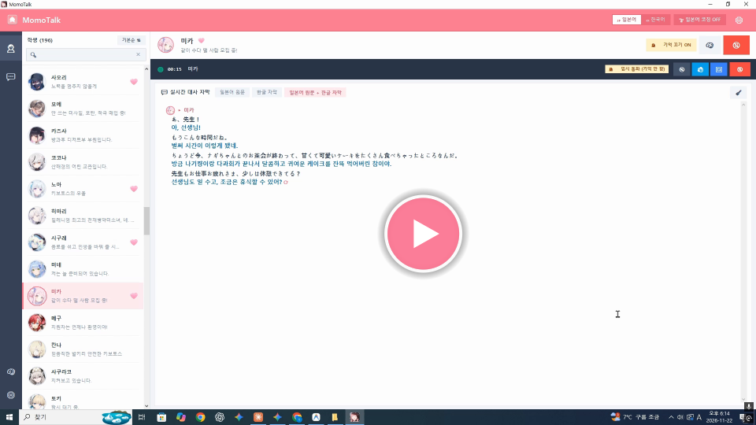

# 블루 아카이브 AI 보이스 컴패니언 (MomoTalk 실시간 음성 대화)

블루 아카이브 학생들과 **실시간 마이크 음성 통화**를 나눌 수 있는 PC 프로그램입니다.
공개 보이스 링크가 등록된 **33명의 학생(의상 변형 페르소나 통합)**이 미리 연결되어 있어, 복잡한 설정 없이 바로 통화를 시작할 수 있습니다.

> ### 📥 바로 다운로드 (Windows 10 / 11 · 약 2.94 MB · 프로필 초상화/아이콘 내장)
> - **[▶ 최신 버전 ZIP 바로 다운로드 (`BlueArchive_VoiceCompanion_Release.zip`)](https://github.com/tsubaki5493-design/blue-archive-voice-companion/releases/latest/download/BlueArchive_VoiceCompanion_Release.zip)**
> - [릴리스 페이지 · 변경 내역 · `SHA256SUMS.txt` 무결성 해시 보기](https://github.com/tsubaki5493-design/blue-archive-voice-companion/releases/latest)
> - **기존 `v1.0.0` 사용자이신가요?** API 키·AI 로그인·대화 기억은 **100% 자동 유지**됩니다. 아래 **🔄 기존 사용자 업데이트 방법** 안내를 확인해 주세요.
>
> **안심 안내:** 100% 공개 Python 소스 코드로만 배포되며, 숨겨진 `.exe` / `.dll` / `.sys` 파일이 전혀 없습니다. 다운로드 후 `SHA256SUMS.txt`로 파일 무결성을 확인할 수 있으며, 자세한 보안 검증 방법은 [`SECURITY.md`](./SECURITY.md)를 확인하세요.

---

## 🎬 실제 사용 시연 영상 (음성 포함 · 18초)

아래 이미지를 클릭하면 **브라우저에서 바로 음성 포함 시연 영상**을 재생할 수 있습니다.

[](https://tsubaki5493-design.github.io/blue-archive-voice-companion/)

- **[▶ 웹 플레이어에서 바로 재생하기 (소리 켜고 시청)](https://tsubaki5493-design.github.io/blue-archive-voice-companion/)** · [MP4 직접 다운로드](https://github.com/tsubaki5493-design/blue-archive-voice-companion/releases/download/v1.0.0/demo_mika_call.mp4)
- *(※ 시연 영상은 개발 환경 녹화 예시이며, 배포판에는 공개 보이스 링크가 확인된 33명 학생의 기본 프로필만 깔끔하게 포함되어 있습니다.)*

---

## ⚡ 30초 시작하기 (딱 3단계!)

### 1단계. 압축 풀고 `1_실행하기.bat` 더블클릭 (기본 실행 파일)
- 폴더 맨 위의 **`1_실행하기.bat`** 을 더블클릭하세요. 모든 기본 기능(음성 통화·설정·메모리·음성 추출/업로드 도구)이 하나의 앱 안에서 통합 실행됩니다.
- *(※ 선택 확장: 본인 Google Colab S2-Pro 무료 전용 음성 서버를 쓰는 경우 **`2_코랩_실행하기.bat`** 으로 1클릭 자동 연결 + 앱 실행을 바로 진행할 수 있습니다. 최초 실행 시 `.venv`가 없으면 `1_실행하기.bat` 설치를 자동 실행합니다.)*
- **최초 1회만** 필요한 파이썬 환경을 자동으로 설치한 뒤 프로그램이 바로 열립니다. (Python이 없어도 공식 자동 설치를 안내하며, 이미 설치된 `.venv`가 있으면 재설치 없이 즉시 실행됩니다.)
- **2회차부터는** 더블클릭하면 바로 열립니다.

### 2단계. Fish Audio API 키 붙여넣기 (최초 1회)
- 처음 실행하면 **초기 설정 창**이 바로 뜹니다.
- **`🔑 키 발급`** 버튼을 눌러 [fish.audio](https://fish.audio/app/api-keys)에서 본인 API 키를 복사한 뒤 **`📋 붙여넣기`** → **`💾 설정 저장 및 적용`** 을 누르세요. (공식 Fish Audio MCP OAuth 웹 크레딧 연동도 설정 창에서 지원합니다.)

### 3단계. AI 엔진(Gemini · Claude · ChatGPT) & 학생 고르고 `📞 통화 시작` 클릭!
- 상단 바(또는 `⚙️ 설정` → 1단계 탭)에서 원하는 AI를 고를 수 있습니다: **✨ Gemini**, **🧡 Claude**, **💬 ChatGPT (GPT)** 모두 기본값인 **🌐 웹 계정 로그인 방식(전용 브라우저 연동 · API 키 불필요)**을 권장합니다.
- **💡 왜 웹 계정 로그인(기본값)을 권장하나요?** 별도의 AI API 키를 발급할 필요 없이 한도 초과(429)·과금 위험과 오류를 최소화하면서 가장 안정적으로 대화할 수 있습니다.
- 왼쪽 목록에서 대화하고 싶은 학생을 선택하고 **`📞 통화 시작`** 을 누르세요.
- 처음 통화할 때 열리는 전용 창에서 선택한 AI(구글 제미니 / 클로드 / 챗지피티) 로그인을 한 번만 완료하면, 이후부터 마이크로 말 걸기만 하면 학생이 일본어(또는 한국어) 목소리와 실시간 자막으로 대답합니다!
  *(※ 고급 사용자용 선택 사항: Google AI Studio · Anthropic Claude · OpenAI 공식 API 키를 직접 사용하고 싶다면 설정 창에서 공식 API 모드로 전환할 수 있으며, 무료 키 호출 한도 및 유료 과금 주의사항을 반드시 확인해 주세요.)*

---

## 🧰 앱 안에서 모든 기능 바로 사용하기

**`1_실행하기.bat`** 으로 열리는 모모톡 메인 화면에서 모든 핵심 기능을 이용할 수 있으며, 선택적으로 **`2_코랩_실행하기.bat`** 으로 Colab S2-Pro 전용 음성 서버에 1클릭 자동 연결할 수 있습니다.

- **실시간 음성 통화 (모드 1 · 기본 / 모드 2 · VB-Cable)**: 기본값인 PC 마이크 직접 대화(모드 1)로 바로 통화할 수 있으며, 필요 시 `⚙️ 설정` → 3단계 탭에서 VB-Cable 오디오 브릿지(모드 2)로 전환할 수 있습니다.
- **선택 확장 — Google Colab S2-Pro 1클릭 자동 연결 (`2_코랩_실행하기.bat`)**: 본인 Google Colab L4/A100에서 Fish Audio S2-Pro 서버를 구동하는 경우, **`2_코랩_실행하기.bat`** 을 실행하면 저장된 서버 재사용 확인 → 오프라인 시 Colab 노트북 자동 열기 및 클립보드/Drive 연결 정보 자동 감지를 거쳐 모모톡 앱을 즉시 실행합니다.
- **스팀 음성 추출 · Fish Audio 일괄 업로드 (`🧰 도구`)**: 상단 **`🧰 도구` → `🎙️ 스팀 음성 추출 · Fish 일괄 업로드`**(또는 `⚙️ 설정` → 2단계 탭)에서 Steam 블루 아카이브 원본 음성 사전 추출, 계정 모델 동기화, 일괄 업로드를 한 화면에서 실행할 수 있습니다. *(※ Steam이 설치되어 있지 않아도 기본 제공되는 33명 공개 보이스로 바로 통화할 수 있습니다.)*
- **선택 확장 — 로컬 실시간 RVC 모드 (`🧰 도구`)**: 로컬 환경에 RVC 런타임(`.venv_rvc` 및 `src/rvc_live/`)이 별도로 구성되어 있는 경우, 상단 **`🧰 도구` → `⚡ 실시간 RVC 모드 (Gemini Live × RVC)`** 메뉴가 자동으로 표시되어 현재 선택한 학생과 언어 설정 그대로 실시간 RVC 창을 열 수 있습니다. *(※ 공개 경량 배포판에는 포함되지 않으며 메뉴가 자동으로 숨겨집니다.)*

---

## ✨ 주요 개선 사항 (v1.1.0)

- **Gemini · Claude · ChatGPT 3대 AI 엔진 지원 및 통화 안정화**:
  - **✨ Gemini**, **🧡 Claude**, **💬 ChatGPT** 모두 웹 계정 로그인(기본 권장 · API 키 불필요)과 공식 API 모드를 지원합니다.
  - 긴 통화 중 모델 응답 오류·404 모델 자동 폴백·보안 확인(Cloudflare/로그인) 복구 흐름과 응답 자막 필터링(코드블록·사고 과정 노이즈 제거)을 강화했습니다.
- **Fish Audio 공식 MCP OAuth 로그인 & Colab S2-Pro 1클릭 연결**:
  - Fish Audio 공식 API 키뿐만 아니라 **공식 MCP OAuth 웹 크레딧 로그인**과 로컬 음성 캐시를 지원해 응답 속도와 편의성을 높였습니다.
  - 선택 확장으로 **`2_코랩_실행하기.bat`** 을 통해 본인 Google Colab S2-Pro 전용 음성 서버에 1클릭 자동 연결할 수 있습니다.
- **33명 캐릭터별 페르소나 차별화 및 장기 대화 기억 유지 강화**:
  - 33명 전원 한국어/일본어 고유 말투(1인칭·호칭·어미·추임새)를 정밀 분리해 캐릭터별 말투 붕괴(존댓말↔반말 역전 등)를 방지했습니다.
  - 20턴·50턴·100턴 이상 이어지는 긴 통화에서도 **주기적 페르소나 재고정**과 **중간 체크포인트 기억 실시간 갱신**으로 캐릭터성과 앞선 대화 맥락을 안정적으로 유지합니다.
- **편의성 · 안정성 · 안전 업데이트 강화**:
  - 실시간 자막 글자 크기 조절(`A+`/`A-`), 음성 볼륨 세밀 조절(10%~200%), 노트북 화면에서도 잘리지 않는 설정 창 스크롤을 개선했습니다.
  - 설정 손상 자동 감지·복구, 앱 내 원클릭 **`🔄 기본값 복원`** / **`🌐 브라우저 초기화`**, 시작 오류 자동 복구 창, 커맨드라인 복구 플래그(`--reset-settings`, `--reset-browser`)를 지원합니다.
  - 기존 폴더 덮어쓰기 업데이트 시에도 **`1_실행하기.bat`** 이 `requirements.txt` 변경 여부를 자동 확인해 추가된 패키지만 빠르게 보강하며, 손상된 `.venv`도 자동 재구성합니다.

---

## 🔄 기존 사용자 업데이트 방법 (v1.0.0 → v1.1.0)

모든 개인 데이터(API 키, AI 전용 브라우저 로그인 세션 `BrowserProfile`, 대화 기억 `memory`, 로컬 음성 캐시)는 프로그램 폴더가 아닌 Windows 사용자 폴더 **`%LOCALAPPDATA%\VoiceCompanionData\`** 에 별도 저장됩니다. 따라서 어떤 방법으로 업데이트하셔도 **기존 API 키·AI 로그인·대화 기억이 100% 그대로 자동 유지**됩니다.

### 방법 A. 새 폴더에 압축 해제 (가장 안전 · 추천)
1. 실행 중인 프로그램과 AI 전용 브라우저 창을 모두 닫습니다.
2. 최신 **[`BlueArchive_VoiceCompanion_Release.zip`](https://github.com/tsubaki5493-design/blue-archive-voice-companion/releases/latest/download/BlueArchive_VoiceCompanion_Release.zip)** 을 **새 폴더**에 압축 해제한 뒤 **`1_실행하기.bat`** 을 실행합니다.
3. 최초 1회 파이썬 환경(`.venv`)이 자동으로 구성된 뒤, 기존 `%LOCALAPPDATA%\VoiceCompanionData\`의 API 키·AI 로그인 세션·대화 기억이 자동으로 연동됩니다.
4. 새 폴더에서 정상 작동을 확인한 뒤 기존 구버전(`v1.0.0`) 폴더만 삭제하시면 깔끔합니다.

### 방법 B. 기존 폴더에 덮어쓰기 (`.venv` 유지 · 빠른 업데이트)
1. 실행 중인 프로그램과 AI 전용 브라우저 창을 모두 닫습니다.
2. 최신 **`BlueArchive_VoiceCompanion_Release.zip`** 의 내용을 **기존 설치 폴더에 그대로 덮어쓰기** 합니다. *(기존 `.venv` 폴더는 유지됩니다.)*
3. **`1_실행하기.bat`** 을 실행하면 `requirements.txt` 변경 여부를 자동 점검해 새로 필요한 패키지만 빠르게 동기화한 뒤 바로 실행됩니다.
4. **⚠️ 참고 (`v1.0.0` 사용자):** 이전 버전에서 `selectors.json`을 직접 편집한 적이 있다면, 업데이트 후 앱 안에서 **`⚙️ 설정 → 🔄 기본값 복원`** 을 한 번 눌러 최신 AI 웹 셀렉터를 반영해 주세요. (Fish Audio API 키·AI 로그인 세션·대화 기억은 그대로 유지됩니다.)

---

## 🛠️ 오류 발생 시 기본값 복구 방법

설정 꼬임, 모델 오류, Cloudflare/로그인 반복, 브라우저 프로필 잠금 등의 문제가 생기면 아래 방법으로 안전하게 복구할 수 있습니다.

### 1. 앱이 정상적으로 열릴 때 (앱 내 원클릭 복구)
- **설정 기본값 복원 (`⚙️ 설정 → 🔄 기본값 복원` 또는 상단 `🧰 도구 → 🔄 설정 기본값 복원`)**
  - **유지:** ✅ Fish Audio API 키 · ✅ AI 전용 브라우저 로그인 세션(`BrowserProfile`) · ✅ 대화 기억(`memory`)
  - **초기화:** AI 엔진(제미니 웹 기본)·모델·추론·자막·프롬프트·보이스 링크·오디오 장치·사용자 `selectors.json` 편집본 *(복원 전 `backups` 폴더에 자동 백업)*
  - 통화 연결 실패 시 화면에 표시되는 오류 배너의 **`🔄 설정 기본값 복원`** 버튼으로도 즉시 실행할 수 있습니다.
- **AI 브라우저 로그인 프로필 초기화 (`⚙️ 설정 → 🌐 브라우저 초기화` 또는 상단 `🧰 도구 → 🌐 브라우저 로그인 프로필 초기화`)**
  - Cloudflare 사람 확인 무한 반복, 웹 로그인 오류, 브라우저 프로필 잠금 오류가 날 때 사용하세요.
  - Fish Audio API 키·앱 설정·대화 기억은 건드리지 않고 전용 브라우저의 AI 웹 쿠키/캐시(`BrowserProfile`)만 깨끗이 비웁니다.

### 2. 앱이 아예 열리지 않거나 시작 오류가 뜰 때
- **자동 복구 창:** 설정 파일 손상 등으로 앱이 시작되지 않으면 **시작 오류 자동 복구 창**이 자동으로 뜹니다. **`예(Y)`** 를 누르면 Fish Audio API 키·AI 로그인 세션·대화 기억을 유지한 채 설정을 기본값으로 복원하고 바로 다시 시작합니다.
- **수동 커맨드라인 복구:** 프로그램 폴더에서 명령 프롬프트(또는 PowerShell)를 열고 아래 명령을 실행하세요.
  ```bat
  1_실행하기.bat --reset-settings
  ```
  *(설정만 기본값으로 복원 후 앱 실행 — Fish API 키·AI 로그인·대화 기억 유지)*
  ```bat
  1_실행하기.bat --reset-browser
  ```
  *(AI 전용 브라우저 로그인 세션 `BrowserProfile` 초기화 후 앱 실행)*

---

## 📋 포함된 캐릭터 목록 (기본 프로필 33명 · 의상 페르소나 통합)

프로필 목록은 깔끔하게 **기본 학생 33명만** 표시되며, 각 학생의 페르소나에는 **수영복·드레스·새해·무장 등 의상 변형 설정이 모두 포함**되어 있습니다.

| 학원 | 학생 이름 | 코드명 | 통합된 의상/변형 페르소나 |
| --- | --- | --- | --- |
| SRT 특수학원 | 요시노 니코 | `Niko` | 기본 |
| SRT 특수학원 | 츠키유키 미야코 | `Miyako` | 수영복 |
| SRT 특수학원 | 카스미자와 미유 | `Miyu` | 수영복 |
| SRT 특수학원 | 텐진야마 오토기 | `Otogi` | 기본 |
| 게헨나 학원 | 리쿠하치마 아루 | `Aru` | 새해, 드레스 |
| 게헨나 학원 | 소라사키 히나 | `Hina` | 수영복, 드레스 |
| 게헨나 학원 | 아마우 아코 | `Ako` | 드레스 |
| 게헨나 학원 | 아사기 무츠키 | `Mutsuki` | 새해, 드레스 |
| 게헨나 학원 | 오니카타 카요코 | `Kayoko` | 새해, 드레스 |
| 게헨나 학원 | 쿠로다테 하루나 | `Haruna` | 새해, 체육복 |
| 밀레니엄 사이언스 스쿨 | 우시오 노아 | `Noa` | 파자마 |
| 밀레니엄 사이언스 스쿨 | 코누리 마키 | `Maki` | 캠핑 |
| 밀레니엄 사이언스 스쿨 | 텐도 아리스 | `Aris` | 메이드, 무장 |
| 밀레니엄 사이언스 스쿨 | 텐도 케이 (Key) | `Kei` | 기본 |
| 발키리 경찰학교 | 네무가키 후부키 | `Fubuki` | 수영복 |
| 백귀야행 연합학원 | 키류 키쿄 | `Kikyou` | 수영복 |
| 붉은겨울 연방학원 | 마요이 시구레 | `Shigure` | 온천 |
| 붉은겨울 연방학원 | 아마미 노도카 | `Nodoka` | 온천 |
| 산해경 고급중학교 | 류우게 키사키 | `Kisaki` | 수영복, 키키(장난 모드 전용 보이스) |
| 아리우스 분교 | 이마시노 미사키 | `Misaki` | 수영복 |
| 아리우스 분교 | 조마에 사오리 | `Saori` | 수영복, 드레스 |
| 아비도스 고등학교 | 스나오오카미 시로코 | `Shiroko` | 라이딩, 수영복 |
| 아비도스 고등학교 | 스나오오카미 시로코 (시로코*테러) | `Shiroko_Terror` | 기본 |
| 아비도스 고등학교 | 이자요이 노노미 | `Nonomi` | 수영복 |
| 아비도스 고등학교 | 타카나시 호시노 | `Hoshino` | 수영복, 무장 |
| 와일드헌트 예술학원 | 이타가키 카노에 | `Kanoe` | 기본 |
| 총학생회 | 총학생회장 | `GSC_President` | 기본 |
| 트리니티 종합학원 | 미소노 미카 | `Mika` | 수영복 |
| 트리니티 종합학원 | 시라스 아즈사 | `Azusa` | 수영복, 레이싱 |
| 트리니티 종합학원 | 유리조노 세이아 | `Seia` | 수영복 |
| 트리니티 종합학원 | 키리후지 나기사 | `Nagisa` | 수영복 |
| 하이랜더 철도학원 | 타치바나 노조미 | `Nozomi` | 기본 |
| 하이랜더 철도학원 | 타치바나 히카리 | `Hikari` | 기본 |

---

## 💡 자주 묻는 질문 (FAQ)
- **Steam 블루 아카이브가 설치되어 있지 않아도 사용 가능한가요?**
  - **네! Steam이 전혀 없어도 됩니다.** 보이스 프로그램과 연동되어 사용하는 프로그램이라 스팀 설치 유무와는 무관합니다.
- **내 API 키나 구글 로그인 정보가 안전할까요?**
  - 모든 개인 설정·API 키·로그인 세션·대화 기억은 사용자 PC의 `%LOCALAPPDATA%\VoiceCompanionData\`에만 저장되며 외부 개발자 서버로 절대 전송되지 않습니다. (상세 검증: [`SECURITY.md`](./SECURITY.md))
- **보조 모드(모드 2 · VB-Cable)를 쓰고 싶어요.**
  - 보안과 라이선스 준수를 위해 드라이버는 포함하지 않았습니다. 필요 시 공식 사이트([vb-audio.com/Cable](https://vb-audio.com/Cable/))에서 직접 설치해 주세요.

---

## 면책 안내
- 본 프로젝트는 비영리 팬 메이드 도구이며, 캐릭터 지식재산권은 원저작자(NEXON Games / Yostar)에 있습니다.
- 모든 AI 추론 및 음성 합성은 사용자가 직접 연결한 본인 계정/API 키로 동작합니다.
